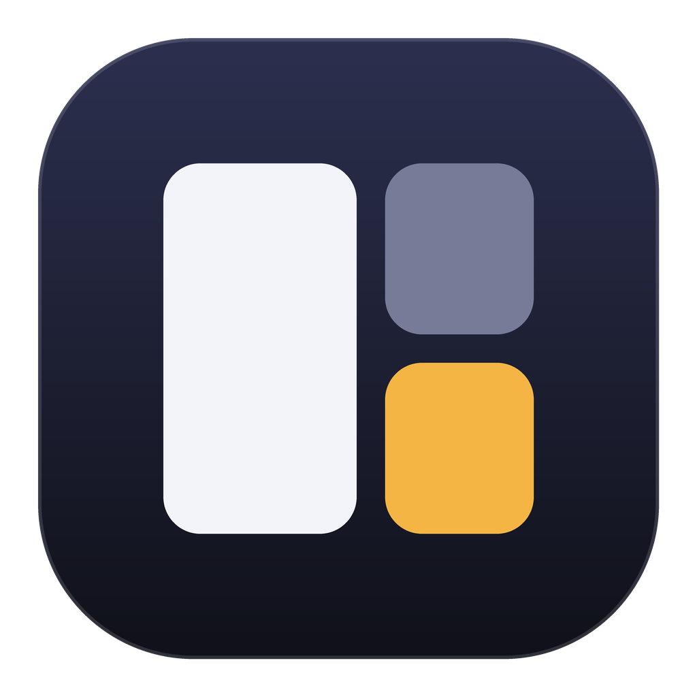
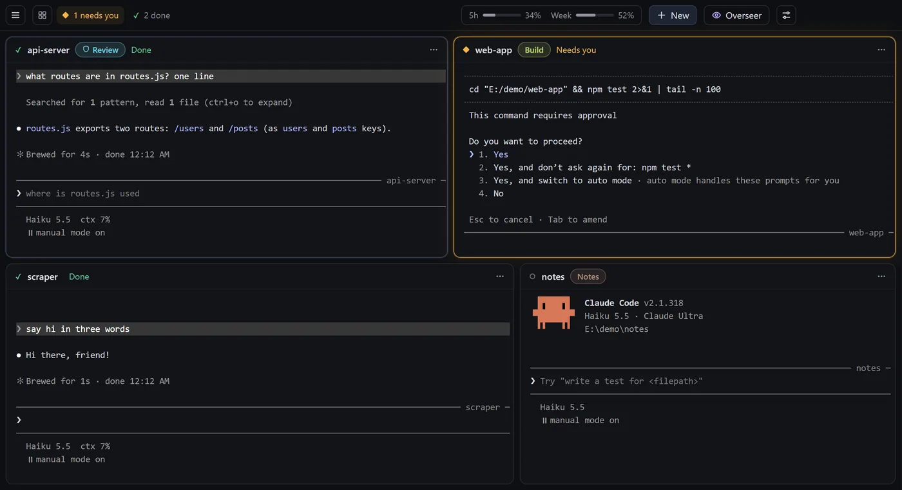

<p align="center">
  
</p>

<h1 align="center">Basanite</h1>

<p align="center">
  A calm home for your Claude Code sessions.<br>
  Every session on one screen, and the one that needs you lights up.
</p>

<p align="center">
  Free and open source, for Mac and Windows. No telemetry, and no extra tokens.
</p>



## What it is

Each tile is the real `claude` command in a real terminal, with your own login, settings, skills and slash commands. Basanite listens to Claude Code's hooks to know what each session is doing. The session that's waiting on you grows and turns amber; the rest stay quiet. The tile you're typing in never moves.

- **Workspaces.** Group sessions ("Client", "School", "Side project") and switch between them. Background sessions keep running, and a hidden workspace shows a dot when something there needs you. Put a workspace away and reopen it later with every session where it was. With one workspace, you never see any of this.
- **Overview.** One list of everything across workspaces, *needs you* first, with a preview. Answer a permission menu right from the preview with a number key.
- **Command palette.** <kbd>⌘K</kbd> / <kbd>Ctrl+Shift+K</kbd> reaches every session, workspace, mode and action. Menus, shortcuts and the palette come from one list, so they always match.
- **Modes.** Put a session in Notes, Plan, Build, Review, Test first, Debug, Until done and more, or make your own. A mode is sent once, not with every message. Review and Plan really block file edits (through a Claude Code hook), and Careful blocks risky commands like push and deploy. Stack add-ons such as *Verify at end* or *Tidy commits* on top. Each mode shows its token cost as dots, and you can share modes as files.
- **Tiles that tell you things.** What it's doing right now ("Editing routes.ts"), its git branch with a peek at the changes, a note when two sessions edit the same file, and a snowflake when the prompt cache has gone cold.
- **The overseer.** A small, lean Claude in a side panel that can see all your sessions. Ask "anything waiting on me?" or have it type a reply for you.
- **Time budgets and Fresh start.** Give a session 30 minutes and it plans to fit. Fresh start writes a handover, clears the context and carries on.
- **Usage.** Your plan's 5-hour and weekly limits, per-session cost, and a 14-day history (costs are estimates at API prices).
- **History.** Search a folder's past conversations and resume one in a tile, or branch a session into a second tile.
- **Terminals too.** A plain shell tile, and if you run `claude` in it, it becomes a full session.
- **Light, dark or system**, high contrast, reduced motion, and a compact density.

## Install

You need [Claude Code](https://code.claude.com) installed and logged in; check that `claude` works in a normal terminal first.

Download the latest build from the [releases page](../../releases/latest).

**Mac.** Open the `.dmg` and drag the app to Applications. The app isn't notarised yet, so the first time, run this once in Terminal (or right-click the app, choose Open, then Open again):

```sh
xattr -cr "/Applications/Basanite.app"
```

**Windows.** Run the setup `.exe`. SmartScreen may not recognise it yet: click **More info**, then **Run anyway**. Claude Code must work as `claude` in PowerShell.

On Windows, updates download quietly and install when you choose Restart to update. On Mac the app tells you when a new version is out.

## Getting started

Drop a project folder on the window, or press <kbd>⌘N</kbd> / <kbd>Ctrl+Shift+N</kbd>. Click a tile and type, exactly like a terminal.

| | Mac | Windows |
|---|---|---|
| Command palette | <kbd>⌘K</kbd> | <kbd>Ctrl+Shift+K</kbd> |
| New session | <kbd>⌘N</kbd> | <kbd>Ctrl+Shift+N</kbd> |
| Next session that needs you | <kbd>⇧⌘U</kbd> | <kbd>Ctrl+Shift+U</kbd> |
| Overview | <kbd>⇧⌘A</kbd> | <kbd>Ctrl+Shift+A</kbd> |
| Next / previous workspace | <kbd>⌃⌘→</kbd> / <kbd>⌃⌘←</kbd> | <kbd>Ctrl+Shift+PageDown</kbd> / <kbd>PageUp</kbd> |
| Mode for the focused session | <kbd>⇧⌘M</kbd> | <kbd>Ctrl+Shift+M</kbd> |

Every shortcut is listed under **Help → Keyboard shortcuts**, or type `?` in the palette. The full guide is on the [docs page](site/src/docs.html).

## Tokens and privacy

- **No extra tokens.** Basanite's hooks reply with nothing unless you've asked for something: a mode or add-on is sent once when it starts (and again after a compaction), a time budget adds a few one-line notes, and a guard mode answers a blocked edit with one line. Counters are read from local files and Claude Code's statusline.
- **The overseer is lean.** It starts from a small context with one tool, and uses nothing when you aren't asking it anything.
- **Private.** No telemetry, no accounts, no server. Sessions are ordinary `claude` processes. Basanite talks to them over `127.0.0.1` with a random key per launch and never changes your global Claude Code settings. The only thing it fetches is the update check from GitHub.

## Development

```sh
npm install     # also restores node-pty's spawn-helper permissions
npm start       # run from source
npm test        # unit tests
npm run dist:mac / npm run dist:win
```

Tagged pushes (`v*`) build every platform in GitHub Actions and attach the files to a draft release.

`bash tools/dev.sh` runs quiet test copies of the app (off screen, own data folder) for scripted checks and screenshots. `docs/` holds the plan, research and build notes.

### How it fits together

- `src/main/` runs the window, one `node-pty` terminal per tile, the local hook server, workspaces, modes and guards, git/history/usage readers, notifications and the overseer.
- Each session starts as `claude --settings <tile settings>`. That file adds HTTP hooks pointing at Basanite and a statusline command; nothing touches your global settings.
- `src/renderer/` is plain HTML, CSS and JS with xterm.js. `commands.js` is the single command list behind the menu, palette and shortcuts.
- `src/shell/` holds the small `claude` wrapper loaded into terminal tiles.
- `src/cli/hangarctl.js` is what Claude Code and the overseer call to talk to the app.

## Licence

MIT. See [LICENSE](LICENSE). The name and logo are not covered by the licence.

Not made by or affiliated with Anthropic.
